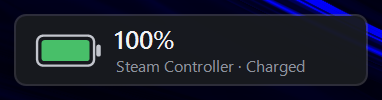
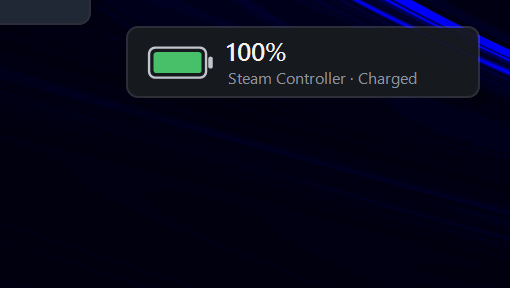

# Pip

A tiny battery widget for the Steam Controller on Windows.



Pip fades in when your controller connects, shows its battery level, and fades out again when it disconnects. It also lives in the system tray, so you can hide the widget and keep just the tray icon.

## Tray menu

Right-click Pip's tray icon to show or hide the widget, jump to Steam's controller settings, start Pip with Windows, reset the widget's position, or quit.



## Features

- Battery percentage with a green / amber / red fill (amber below 50%, red below 20%)
- Charging and fully-charged indicators
- Appears on connect, disappears on disconnect
- Never steals focus from your game
- Drag it anywhere; it remembers where you put it
- Tray-only mode: hover the widget and click the ×, or untick **Show widget** in the tray menu
- Up to four controllers on one wireless puck
- Works across multiple monitors with different scaling
- Shortcut to Steam's controller settings in the tray menu
- Optional **Start with Windows**
- Steam does not need to be running
- One small exe, nothing to install

## Download

Grab `Pip.exe` from the [Releases](../../releases) page and run it. Windows may show a SmartScreen warning because the exe is not code-signed; choose **More info → Run anyway**, or build it yourself (below).

## Using it

| Action | How |
| --- | --- |
| Move the widget | Drag it |
| Hide the widget, keep the tray icon | Hover the widget and click ×, or untick **Show widget** in the tray menu |
| Bring the widget back | Double-click the tray icon |
| Open Steam's controller settings | Right-click the tray icon → **Steam controller settings** |
| Start with Windows | Right-click the tray icon → **Start with Windows** |
| Quit | Right-click the tray icon → **Exit** |

## Compatibility

- **Not supported:** the original 2015 Steam Controller, which uses a different protocol.
- Pip is a normal always-on-top window, so it shows over borderless and windowed games but not over exclusive fullscreen.

## Building

Pip is a single C# file with no dependencies. It builds with the compiler that ships with Windows, so you don't need Visual Studio or the .NET SDK:

```bat
build.cmd
```

That produces `Pip.exe` next to the source, with its icon taken from `assets\Pip.ico`.

## How it works

Pip opens the controller's vendor-defined HID interface read-only and listens for its battery report (`0x43`: charge state and level in percent) and its wireless connect / disconnect report. The report layout comes from [SDL's Steam Controller driver](https://github.com/libsdl-org/SDL/blob/main/src/joystick/hidapi/SDL_hidapi_steam_triton.c). Pip never writes to the controller, so it doesn't interfere with Steam or with games.

Settings (widget position and tray-only mode) are stored in `%AppData%\Pip`. Run `Pip.exe --log <file>` to write connection and battery events to a log file for troubleshooting.

## Disclaimer

Pip is an unofficial, fan-made tool. It is not affiliated with or endorsed by Valve. Steam and Steam Controller are trademarks of Valve Corporation.
